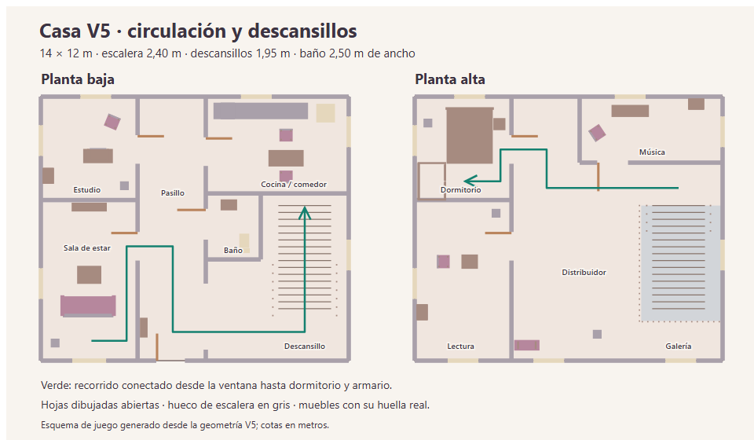

# Casa V5: espacio, atmósfera y entrada por ventana

Encargo del 8 de noviembre de 2026. Base: `192fc34`. Rama: `codex/casa-v5-espacio-atmosfera`. El propietario pidió analizar la casa a fondo, corregir su circulación, mejorar el sonido y la sensación al jugar, presentar la entrada por ventana y publicar los cambios verificados.

## Diagnóstico y decisiones

La V4 tenía una escalera transitable, pero su entorno era estrecho: la barandilla quedaba a 13,25 cm del muro, el espacio inferior tenía 75 cm de fondo y el superior 1,10 m. Poder atravesarla con el pequeño radio del jugador no demostraba que el espacio resultara cómodo ni que se pudiera girar con naturalidad.

También había problemas de distribución: la silla del estudio estaba al otro lado del escritorio respecto al cajón; ambas sillas del comedor miraban en la misma dirección; varias estanterías daban la espalda al espacio de uso o invadían visualmente las ventanas. La puerta del estudio reducía el paso junto al escritorio. El baño necesitaba más anchura.

La antigua entrada era principalmente un desplazamiento de cámara de 3,45 segundos y se omitía en «Casa 3D» desde Pruebas. El ambiente consistía en tres tonos continuos, además de la música de tensión; los pasos y mecanismos se representaban con tonos breves similares.

| Medida libre | V4 | V5 |
| --- | ---: | ---: |
| Casa | 12 × 10 m | 14 × 12 m |
| Ancho de peldaños | 1,90 m | 2,40 m |
| Desarrollo de la escalera | 4,60 m | 5,00 m |
| Descansillo inferior hasta pared | 0,75 m | 1,95 m |
| Descansillo superior hasta pared | 1,10 m | 1,95 m |
| Barandilla hasta muro este | 0,1325 m | 0,4025 m |
| Ancho del baño | 1,80 m | 2,50 m |

Se amplían la envolvente y el hueco de escalera, con altura continua y pasamanos inclinados. Se protege el hueco superior con barandillas. El acceso inferior conecta directamente con el pasillo mediante una abertura de 3 m. El comedor, baño, mobiliario de lectura y jardín se recolocan de acuerdo con la nueva casa. La cocina conserva la trampilla cerrada para el futuro sótano.

Las puertas del estudio y baño abren hacia un pasillo con espacio libre. La apertura automática comienza a 2 m y conserva el cierre manual hasta alejarse de la zona. Durante una animación se reserva su recorrido pendiente: caminar hacia una hoja o bandeja en movimiento ya no deja al jugador y al mueble bloqueados entre sí. El arco se comprueba contra el cuerpo en cada avance; se conserva la colisión real del mueble.

[Escalera nueva](capturas/casa-v5/05-escalera-espacio.png) · [Descansillo superior](capturas/casa-v5/06-descansillo-superior.png) · [Baño](capturas/casa-v5/08-bano.png) · [Cocina](capturas/casa-v5/09-cocina.png) · [Estudio](capturas/casa-v5/10-estudio.png) · [Lectura](capturas/casa-v5/11-lectura.png).



[Plano vectorial](capturas/casa-v5/plano.svg) · [Medidas V4](capturas/casa-v5/before/espacios.json) · [Auditoría V5](capturas/casa-v5/after/espacios.json).

## Comprobación del espacio completo

La auditoría explora el suelo conectado desde la entrada por ventana, con muestras cada 20 cm y un cuerpo de 64 cm de diámetro, más ancho que el radio habitual del juego. Usa las alturas, paredes, muebles, puertas abiertas y huecos reales; comprueba también los puntos intermedios de cada paso.

En la geometría final se conectan 4.081 muestras. Se alcanzan las doce posiciones de referencia: pasillo, estudio, salón, cocina, baño, ambos descansillos, dormitorio, armario, lectura, música y galería. Desde esa misma región conectada se encuentran posiciones con alcance y visión válidos para nota, cajón, llave, cuadro, dormitorio, armario, escondite bajo la cama, Louis y trampilla. Se comprueba la altura libre a lo largo de toda la escalera.

Esto evita conformarse con teletransportar al jugador a un punto aislado que parezca libre. La auditoría no sustituye la prueba de movimiento: el navegador también cruza desde el pasillo al descansillo, sube y baja con entradas reales. Las puertas se atraviesan en la simulación de navegación, incluida una aproximación a velocidad de marcha mientras se abren.

## Entrada en primera persona

La secuencia dura 6,2 segundos: aproximación desde el jardín, apertura de la hoja, manos apoyadas en el alféizar, elevación del cuerpo, paso por la abertura, descenso y recuperación de la postura de pie. Cámara, hoja y manos tienen geometría y posiciones reales. Hay sonidos sincronizados de pestillo, ventana, ropa y apoyo al caer.

Se presenta al comenzar el recorrido normal y al entrar en el primer checkpoint «Casa 3D». Los checkpoints avanzados conservan su inicio directo. Se puede pausar con el botón o Escape, reanudar, saltar y regresar al menú. La pérdida de foco y la orientación vertical detienen la secuencia y el audio; ambos se recuperan al continuar. Movimiento reducido entrega directamente el control en el mismo punto seguro, con la ventana abierta. Se comprueba que la cámara no atraviesa pared, alféizar ni muebles en todo el recorrido.

[Grabación visual de la entrada](capturas/casa-v5/entrada-por-ventana.webm) · [Apoyo y ascenso](capturas/casa-v5/02-ventana-trepar.png) · [Aterrizaje](capturas/casa-v5/03-ventana-aterrizar.png). La grabación de Playwright muestra la imagen; el audio se verifica por separado.

## Sonido y sensación de movimiento

El ambiente original se genera con Web Audio: viento filtrado y grillos fuera; aire interior, crujidos espaciados, zumbido de frigorífico en la cocina y ruidos breves de tuberías en el baño. Las capas cambian gradualmente entre exterior e interior y se atenúan al esconderse. Se reutiliza un único búfer de ruido para las capas y los sonidos físicos.

Los pasos distinguen madera, baldosa, hierba y piedra. Puertas, cajón, pestillo, ropa y ventana usan impulsos y ruido filtrado con envolventes suaves. La linterna tiene una inercia pequeña al girar; movimiento reducido elimina ese desplazamiento. Se recolocan las luces cálidas junto a las lámparas de las nuevas posiciones.

La música de tensión mantiene su volumen independiente. «Ambiente», «Efectos» y silencio siguen usando la preferencia de sonido de la casa; no se cambian claves de partidas. Hay tres fuentes continuas de ambiente y un máximo de ocho voces ambientales breves. La pausa suspende el contexto, detiene la programación y libera eventos; salir destruye fuentes, filtros y contexto. No se añaden archivos de audio externos ni paquetes.

La prueba mide una señal real con música y efectos a cero, verifica grillos en el jardín y tuberías en el baño, y comprueba silencio y cierre de contextos. Los valores completos están en [resultados V5](capturas/casa-v5/resultados.json).

## Rendimiento

Se conservan WebGL1, el atlas pequeño y los modos Detalles/Fluido. El render escribe primero la profundidad de puertas y paredes opacas para evitar sombrear superficies ocultas del jardín o de otras habitaciones. La escena aislada baja de 11.628 a 11.460 triángulos pese al aumento de espacio; los pasamanos continuos sustituyen muchas piezas pequeñas.

Comparación con `192fc34`: Chromium 158, SwiftShader por software, viewport 960 × 540, mismas cámaras y linterna, 40 muestras después de 10 fotogramas de calentamiento por vista/calidad.

| Vista / calidad | Resolución interna | Mediana V4 | Mediana V5 | P90 V4 / V5 |
| --- | --- | ---: | ---: | ---: |
| Pasillo / Detalles | 768 × 432 | 25,9 ms | 31,9 ms | 28,8 / 37,8 ms |
| Exterior / Detalles | 768 × 432 | 15,2 ms | 24,0 ms | 16,0 / 25,8 ms |
| Pasillo / Fluido | 528 × 297 | 7,6 ms | 9,1 ms | 9,1 / 10,0 ms |
| Exterior / Fluido | 528 × 297 | 6,1 ms | 5,4 ms | 7,1 / 6,2 ms |

La casa más grande tiene coste visible en Detalles. Se conserva la adaptación automática a Fluido. Son tiempos de render aislado por software, sensibles a la carga del PC; no representan los FPS sostenidos de la aplicación ni certifican un teléfono. [Datos V4](capturas/casa-v5/before/mediciones.json) · [Datos V5](capturas/casa-v5/after/mediciones.json).

## Verificación y protección

Las pruebas ejecutadas cubren `npm test` (incluye ahora la auditoría espacial), `npm run build`, navegador V5, regresión de puertas/cajón/armario/música, dos contactos táctiles, foco, rotación, pausa, movimiento reducido, reinicio, recorrido de cumpleaños y rescate, historia 2D y compilación de producción. Los informes JSON y capturas se conservan bajo `docs/capturas/casa-v5/`.

Los tests V5 y de mecanismos terminaron sin errores JavaScript. La regresión 3D registró movimiento y mirada simultáneos con dos contactos (0,93 m y 0,275 rad), tres contextos de audio cerrados y guardados protegidos sin cambios. [Mecanismos y armario](capturas/casa-v5/mecanicas/resultados.json) · [Regresión de controles y cajón](capturas/casa-v5/regresion/resultados.json).

Las fuentes de producto modificadas están exclusivamente en `src/lab/`: distribución, mundo, navegación, interacciones, render, mano/linterna, ventana, casa, CSS propio, iluminación y sonido; `atmosphere.js` es nuevo. Las pruebas adaptadas son `lab.cjs`, `house-navigation.cjs`, `window-intro.cjs`, `house-3d-browser.cjs`, `house-v4-browser.cjs` y `house-v4-renderer.cjs`. En `demo-browser.cjs` solo se actualiza la posición esperada del aterrizaje 3D. Se añaden `house-space-audit.cjs` y `house-v5-browser.cjs`.

El 2D, la orquestación, sprites, música 2D, CSS compartido, assets públicos, dependencias y claves de guardado permanecen intactos. Se conserva byte por byte el guardado válido de historia y rescate al salir de las pruebas.

Para repetir la comprobación principal:

```powershell
npm test
npm run build
node tests/house-v5-browser.cjs
$env:HOUSE_QA_DIR='docs/capturas/casa-v5/mecanicas'
node tests/house-v4-browser.cjs
$env:HOUSE_QA_DIR='docs/capturas/casa-v5/regresion'
node tests/house-3d-browser.cjs
node tests/demo-browser.cjs
npm run test:browser
$env:HOUSE_QA_DIR='docs/capturas/casa-v5/production'
node tests/house-production-browser.cjs
```

Pendiente: escucha, control y rendimiento sostenido en Safari/iPhone físico. El vidrio sigue siendo una aproximación opaca y las sombras tienen la resolución simplificada del motor actual. El sótano continúa reservado para una ampliación posterior.
